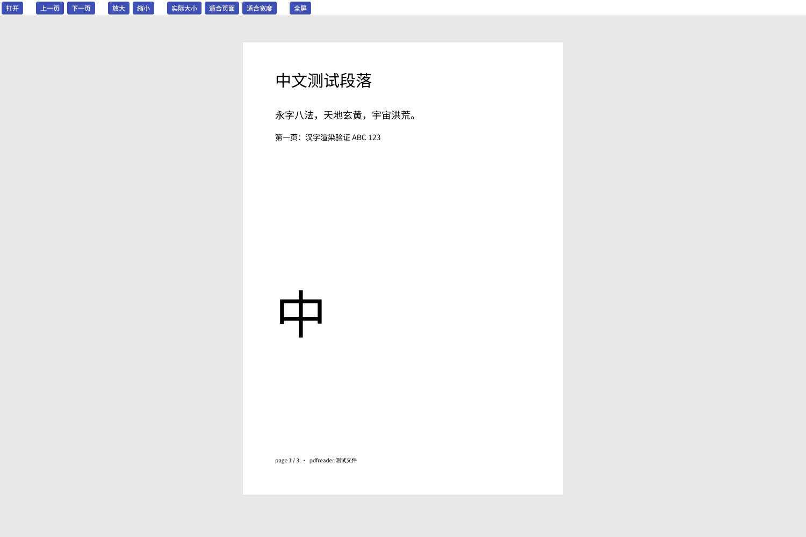

# pdfreader

极简中文 PDF 阅读器，Go + Gio + go-fitz（MuPDF）。当前版本 `0.1.0`。



## 下载与安装

从 [Releases](https://github.com/nivrrex/pdfreader/releases/latest) 下载最新版本：

- **Linux amd64（tar.gz）**：pdfreader_0.1.0_linux_amd64.tar.gz
- **Linux amd64（deb，Debian 12+ / Ubuntu 22.04+）**：pdfreader_0.1.0_amd64.deb
- **Windows amd64**：pdfreader_0.1.0_windows_amd64.zip
- 校验和：SHA256SUMS

### Linux

```bash
tar -xzf pdfreader_0.1.0_linux_amd64.tar.gz
cd pdfreader_0.1.0_linux_amd64
./pdfreader
```

或安装 deb：

```bash
sudo dpkg -i pdfreader_0.1.0_amd64.deb
sudo apt install -f
```

Linux 需要常见的 X11/Wayland、EGL、xkbcommon 运行库；阅读中文 PDF 还需系统中文字体，建议安装 `fonts-noto-cjk`。

### Windows

解压 zip 后运行 pdfreader.exe。程序未签名，SmartScreen 可能提示“未知发布者”。系统要求 Windows 10/11 x64（UCRT）；PDF 内中文依赖系统中文字体（通常为微软雅黑或宋体）。Windows 版在 Linux 上交叉构建并通过 PE 检查，尚未在真实 Windows 环境完成完整回归。

## 功能

- 打开 PDF、翻页、缩放、全屏。
- 内嵌 Noto Sans SC，UI 中文不依赖系统字体。
- 视图：实际大小、适合页面、适合宽度。
- 页面按渲染像素 1:1 绘制，缩放通过重新调用 `ImageDPI` 实现；超出窗口时按住左键拖动查看。
- 顶部按钮栏浮层显示，鼠标离开上部自动隐藏；页面区域占满窗口。
- 普通滚轮翻页，`Ctrl + 滚轮` 缩放。
- “打开”按钮弹出内置文件面板，可浏览当前目录、上级目录、子目录和 `*.pdf`。
- 翻页或缩放失败时保留当前页面，并在底部显示错误原因。

## 目录结构

```
main.go              窗口创建、事件循环、启动文件加载
reader.go            go-fitz 文档状态、ImageDPI 渲染、翻页与缩放
ui.go                工具栏、页面绘制、键盘/滚轮/拖动、全屏
picker.go            内置文件选择面板
fonts.go             内嵌中文字体与 material.Theme
assets/              NotoSansSC-Regular.ttf、图标 SVG/PNG/ICO、Windows 资源
testdata/            中文样例与加密 PDF 测试夹具
reader_test.go       Reader 状态、错误路径与资源生命周期测试
ui_test.go           无效交互不重置视图的测试
pdfreader.desktop    Linux 桌面入口
scripts/             Windows 交叉构建脚本
go.mod / go.sum      依赖锁定
```

## 构建

### Linux

要求：

- Go 1.24 或更高版本，开启 cgo。
- 需要 X11/Wayland/EGL 开发头文件和 pkg-config 文件。
  Devuan/Debian 上至少需要：
  `libx11-dev`、`libx11-xcb-dev`、`libxcursor-dev`、`libxfixes-dev`、
  `libxkbcommon-dev`、`libxkbcommon-x11-dev`、`libegl1-mesa-dev`、
  `libwayland-dev`、`pkg-config`。
- 首次构建会编译/链接 go-fitz 捆绑的 MuPDF 静态库，耗时较长。

```bash
go build -trimpath -buildvcs=false -o pdfreader .
```

### Windows amd64

推荐在 Linux 上安装 Zig 0.17.1 后运行：

```bash
./scripts/build-windows.sh
```

脚本生成 `pdfreader_windows_amd64.exe`，使用 go-fitz 捆绑的 MuPDF 静态库，
不需要额外提供 `libmupdf.dll`。已验证该命令能生成 GUI 子系统 PE32+ amd64 文件，
导入表只有 Windows 系统库，没有 MuPDF DLL。普通 MinGW 不能直接链接这套库，
因为静态库包含 MSVC 的内部符号；Zig 的 Windows GNU 目标可以处理。

`CGO_ENABLED=0` 的 Windows 构建会使用 go-fitz purego 实现，运行时必须加载
`libmupdf.dll`。该 DLL 的 MuPDF 版本必须与 `go-fitz` 的 `FzVersion`（当前为
`1.28.0`）一致，并放在 exe 同目录或 Windows DLL 搜索路径中；缺失时程序会在
启动时 panic。没有经过验证的 DLL 来源时，应使用上面的静态构建脚本，不要发布
仅有 exe 的 purego 构建。

## 运行

```bash
./pdfreader testdata/test-cn.pdf
```

无参数启动时只显示“请打开 PDF”，不会自动尝试打开任何文件；点击“打开”选择文件。
只接受一个命令行参数（PDF 路径），没有其他选项。

## 操作

| 操作 | 行为 |
|---|---|
| `+` / `=` | 放大一级 |
| `-` | 缩小一级 |
| `PgUp` / `←` / `↑` | 上一页 |
| `PgDn` / `→` / `↓` | 下一页 |
| `F11` | 切换全屏 |
| `Esc` | 关闭文件面板；否则退出全屏 |
| 普通滚轮 | 上一页 / 下一页 |
| `Ctrl + 滚轮` | 缩小 / 放大 |
| 按住左键拖动 | 页面大于窗口时平移 |
| 鼠标移到窗口上部 | 显示按钮栏；离开后自动隐藏 |

## 实现要点

- `Reader` 持有 `*fitz.Document`，所有 `ImageDPI` 调用都在事件循环 goroutine 中顺序执行；
  `Reader` 不是线程安全的，不要跨 goroutine 调用。
- 翻页和缩放先在候选状态完成渲染与 `Bound` 读取，全部成功后才提交页码、zoom 和位图；
  失败时保留旧页面。打开失败时也会关闭 go-fitz 已创建但未返回的文档资源。
- `Render()` 使用 `DPI = 72 × zoom`，并把 DPI 钳制在 `[24, 600]`；zoom 钳制在 `[0.2, 5.0]`。
- 页面不使用 `widget.Image` 的 `Fit` 缩放，而是按渲染后的像素 1:1 绘制，
  避免“页面不动、只是像素变清晰”的假缩放；适配模式在布局阶段按窗口尺寸计算 zoom。
- `Reader.BaseSize()` 返回 PDF 点尺寸，用于适合页面/适合宽度计算。
- 字体通过 `go:embed` 嵌入，`text.NoSystemFonts()` 保证 UI 只用内嵌字体。
  注意：PDF 内部中文由 go-fitz 的 MuPDF 系统字体回退渲染，需要系统安装
  Noto CJK（deb 依赖 `fonts-noto-cjk`）。
- Gio v0.10.3 的 `Clickable.Clicked` 必须在 `Layout` 之前调用；工具栏按钮按此顺序处理。
- 文件面板用 `widget.List`，必须显式设置 `Axis = layout.Vertical`（默认是横向）。

## 图标与桌面文件

- 图标源：`assets/pdfreader.svg`；PNG：`assets/icons/pdfreader-{16,24,32,48,64,128,256,512}.png`；
  Windows ICO：`assets/pdfreader.ico`。
- Windows 图标资源：`assets/pdfreader.rc` 与根目录 `pdfreader_windows_amd64.syso`，
  `GOOS=windows GOARCH=amd64` 构建时会自动嵌入到 exe。
- 桌面入口：`pdfreader.desktop`，`Exec=pdfreader %f`，`Icon=pdfreader`，
  `MimeType=application/pdf;application/x-pdf;`。
- deb 安装包可从 GitHub Releases 下载。

## 测试与验证

```bash
go test -mod=readonly -count=1 ./...
go test -mod=readonly -race -shuffle=on ./...
```

自动化测试覆盖：

- 中文样例的页数、72 DPI 基准尺寸、首页/末页和重复关闭。
- zoom 的 `0.2`/`5.0` 钳制，以及到达上下限后的无效操作。
- 真实 go-fitz 越界页错误触发时的状态回滚与错误上下文。
- 文件缺失、无效 PDF、加密 PDF 的打开错误路径。
- 首页、末页、缩放上下限和“实际大小”无变化时保留平移与适配状态。

历史手动验证还包括中文 PDF 在 36/72/144 DPI 下渲染、按钮、键盘、滚轮、全屏、
文件面板、拖动平移、退出清理，以及 deb 安装和卸载。

## 许可

本项目原创代码使用 MIT 许可证（`LICENSE`）。发布二进制静态链接了 MuPDF，而 MuPDF 使用 AGPL-3.0，因此发布二进制整体按 AGPL-3.0 分发；第三方组件与完整许可证文本见 `THIRD_PARTY_NOTICES.md` 和 `LICENSES/`。

## 已知限制

- zoom 低于约 0.333 时，DPI 下限 24 生效，位图分辨率不再增加。
- 页面平移只支持鼠标左键拖动，没有滚动条。
- 文件面板只显示目录和 PDF，跳过隐藏文件，不支持输入路径。
- 9 个按钮在很窄的窗口下可能横向溢出。
- “实际大小”按 1 PDF 点 = 1 dp（100% 逻辑像素）实现，不按物理英寸校准。
- Linux 在 Devuan 5 + X11 下完成运行验证；Windows amd64 已完成静态交叉构建和
  PE 导入表检查，但未在真实 Windows 运行，macOS/Wayland/其他 HiDPI 比例未实测。
- 无文本搜索、目录/书签、打印、密码 PDF 解锁。
